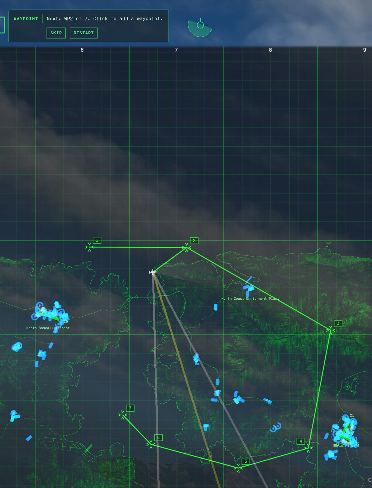
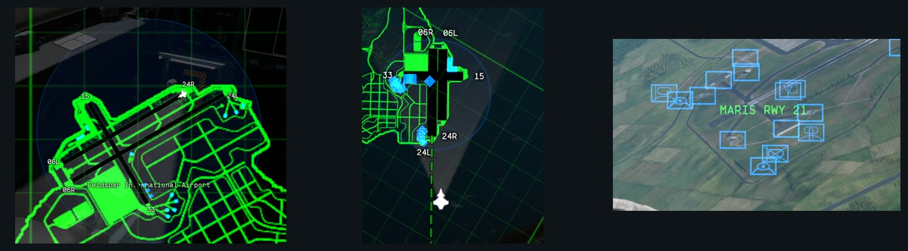
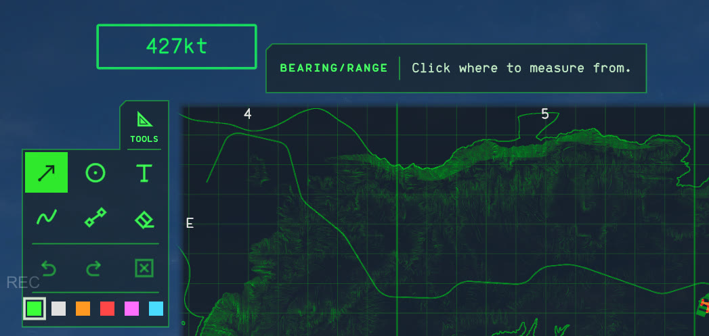
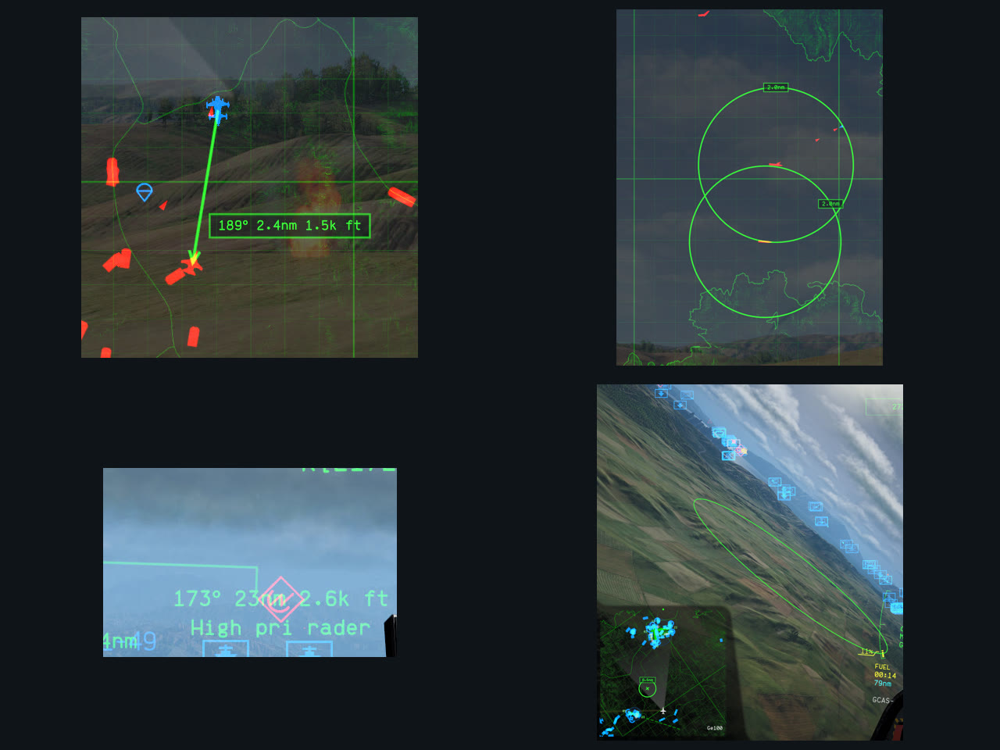

# NO Map Overhaul

My map mod for Nuclear Option: numbered runways with an approach line and a runway callout for ATC, planning tools on the full map that you can share with your flight, and airbase names.

**To install it, add NO Map Overhaul in Nuclear Option Mod Manager, or follow the [install guide](docs/INSTALL.md).**

Up to 0.4.0 this mod was called Baanish UI Improvements. If you had it, delete `BepInEx/plugins/BaanishUiImprovements` when you install this; your settings carry over. Its missile arrows are now a mod of their own, [NO Missile Indicators](https://github.com/baanish/NO-Missile-Indicators).

Drawing sharing, new in 0.6.0 and off by default, shows your map drawings to teammates on your side who run the mod, on channels you name. Shockfront's dev team reviewed the design in October 2026 and said it's fine. The [sharing guide](docs/SHARING_GUIDE.md) shows how to set it up with your flight. To turn everything off without uninstalling, switch off **General → Enabled** in the settings.

## Runway markers

- **Runways on the map.** Each friendly runway is a black strip with white numbers in a black outline, so it stands out over the map's bright green linework. Its number sits past each end, so the west end of an east-west runway reads 09 and the east end 27, and zoomed in far enough it moves onto the runway, the way it's painted. Parallel runways get L, C or R. The numbers come from the runway heading, the same way the game numbers its landing clearance, and a setting shows the paint instead on the two Ignus runways painted differently. A dashed centre line runs down each runway. Every colour and size is a setting.
- **Approach line.** Within 5 km, a dashed 5 km centerline extends off the nearest end of the nearest runway, so you can judge the turn onto final. Each dash plus its gap is 500 m, so the dashes double as distance ticks.
- **HUD callout.** The same runway end gets a label pinned over its threshold in the 3D view, ready for an ATC call, naming the airbase too (`NBSCLI RWY 27`). Options drop the airbase name and hide the label until your gear is down.
- **Airbase boundary.** A faint shaded circle in the game's friendly map colour marks each friendly airbase's landing zone. Stop inside it after landing and the sortie ends as returned instead of crashed.

It doesn't guess which way you'll land. It always shows the end you're closest to. Helicopters get the airbase boundary but no runways (the Tarantula tiltrotor lands on runways, so it counts as a plane), and carriers are left out because the ship's own icon already marks the deck.

## Map tools

On the full map, click **Tools** or press `H` to open a rail of planning tools beside the map. The number keys pick a tool:

1. **Bearing/range** draws an arrow labelled with its bearing and range. End it on a contact and the label adds the contact's altitude, like a BRA call, and follows it.
2. **Circle** draws a range ring, which also shows as a ring in the 3D view.
3. **Text** places a note. Put it on a contact to tag it, and the tag follows the contact.
4. **Pen** draws freehand lines.
5. **Waypoint** builds a numbered route, with the next two waypoints labelled in the 3D view.
6. **Eraser** deletes a drawing.

Drawings clear when you leave the mission. A drawing on another unit uses only what your side knows. When your side loses the contact, the drawing stops where it was last seen and reads `lost`. A shared drawing on a unit works the same way from the recipient's own tracks, and stays hidden only while the recipient's side has never known the unit.

The tools work alongside [NOAutopilot](https://github.com/qwerty1423/no-autopilot-mod). Its right-click waypoints work as usual while the rail is closed. While the rail is open, an optional NOAutopilot patch holds them back, so a right click that deletes a drawing doesn't also move your autopilot route.

See the [map tools guide](docs/MAP_TOOLS.md) for every tool, the keys, and planning ideas.

## Airbase names

Your side's airbases get a name label on the full map, so you can find the one someone just called out. That includes airbases a mission adds and ones your side captures. Enemy and neutral airbases get no name, since the game doesn't mark them.

## Shared drawings

Turn on sharing, name a channel such as `viper`, and everyone in your flight on the same channel sees each other's drawings on the map and minimap, with arrows, notes and circles in the 3D view too. Sharing works on player-hosted games and Steam dedicated servers, needs no server mod, and stays within your side. Point at a teammate's drawing to see who drew it.

The [sharing guide](docs/SHARING_GUIDE.md) shows how to set it up, and [sharing](docs/SHARING.md) covers the design and its limits.

## Install

Download `NoMapOverhaul-v<version>-plugin-only.zip` from [releases](https://github.com/baanish/NO-Map-Overhaul/releases) and follow the [install guide](docs/INSTALL.md). It covers BepInEx, checking the mod loaded, upgrading from Baanish UI Improvements, updating, and uninstalling.

The [user guide](docs/USER_GUIDE.md) covers every setting, how the runway end is chosen, the airbase abbreviations, and how to measure the mod's cost on your machine.

## Contributing

Bug reports and ideas are welcome. Include your game and mod versions, a screenshot, and what you expected to see. See [contributing](CONTRIBUTING.md) to build it yourself.

## License

[MIT](LICENSE). The waypoint reach rule is adapted from NOAutopilot, also MIT; see [third-party notices](THIRD_PARTY_NOTICES.md). Nuclear Option and its assets belong to their respective owners.
