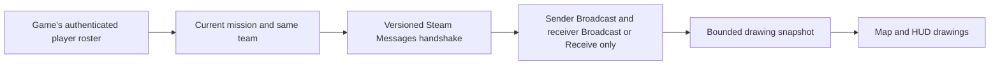

# Drawing sharing

To set sharing up with your flight, read the [sharing guide](SHARING_GUIDE.md). This page is the technical reference: how channels route drawings, the network design and its security checks, and every limit.

Sharing sends map drawings, including ones attached to units, to compatible Steam teammates. It starts off. Both clients need a build that speaks protocol version 6, 0.6.0 beta 3 or later. Earlier builds can't pair, and the status line shows such a teammate as on another version. [Testing](TESTING.md) records the two-PC checks.

An opposing faction never receives drawings, even if it uses the same channel names. Spectators don't receive drawings in 0.6.0. Sharing works on player-hosted and Steam dedicated servers. UDP sessions stay local-only. The client-only build has no cross-faction or host override.

## Channels and ownership

On the full map, open **Tools → Channels**. **Broadcast** channels send, receive, and allow collaboration. **Receive only** adds channels whose drawings you can view but can't edit. If a name is in both lists, Broadcast wins. Choose sharing on or off, then click **Apply**. Both fields turn typed and pasted capitals lowercase as you type. The **Draw to** indicator names the channel new drawings go to. Click a numbered Broadcast button to change it. **Cancel**, Escape, or closing the map discards unapplied edits. Invalid input shows an error and leaves both active lists unchanged. These controls save to the existing config file and don't appear in F1 settings.

For example, player A broadcasts `command,medusa`. Player B broadcasts `ifrit` and lists `command` under Receive only. B sees A's `command` drawings but can't send to or erase on `command`. A drawing reaches a teammate only when its channel is in the sender's Broadcast list and in either of the recipient's lists. Each list takes up to ten comma-separated names, 32 characters per name, and 512 characters in total. Names use ASCII letters, digits, spaces, dots, underscores, or hyphens. The mod trims them and makes them lowercase, and duplicate names collapse to one slot. Invalid input in the config file disables sharing until you correct it.

New drawings start on the first Broadcast channel. With the full map open, the default keys Shift+1 through Shift+9 select Broadcast slots 1 through 9, and Shift+0 selects slot 10. Either Shift key works. Rebind **Channel 1 key** to **Channel 10 key** in **F1 → Map Tools / Keys and Limits**, with **Advanced settings** ticked. Receive channels take no number slots. Chat, text entry, and menus keep their input. Changing the destination cancels an unfinished drawing. A drawing keeps its original channel when you reorder the settings or edit, undo, or redo it. On the map, every drawing on another channel, yours or a teammate's, draws half as opaque and darker by default (**Other channels opacity** and **Other channels brightness** set this), so switching channels shows which drawings the new one covers. The Waypoint tool's guide line dims with its route.

With an empty Broadcast list, new drawings stay local. A receive-only player sees subscribed drawings without sending any. Drawings on channels you no longer broadcast stay yours but stop being shared. Changing teams makes all earlier drawings local-only, including anything undo or redo can restore. Leaving the mission discards drawings and history.

Received drawings never enter the local drawing store. On the full map, pointing at one names its owner beside the cursor, from the game's player roster (see [where drawings show](MAP_TOOLS.md#where-drawings-show)).

The Eraser and right click can ask the original owner to erase a received drawing when both players broadcast its channel. The highlight also checks the owner's advertised lists and current request cooldown. The drawing stays visible until its owner publishes the deletion. A successful send isn't the owner's confirmation. After the erase, redraw a replacement on that Broadcast channel. Receive-only channels stay read-only, and a visible read-only drawing under the cursor blocks erasing a local drawing directly beneath it. Drawings with zero alpha don't take eraser hits.

Clear, undo, redo, and waypoint navigation affect only your work. An accepted shared erase is one edit in the original owner's history. It clears that owner's redo branch, and the owner can undo it and share the restored drawing. It adds no undo step for the requester.

Channel membership is an honor system. Any same-faction teammate with this mod can claim a channel name, so a channel doesn't enforce a private command role. Received routes show on the maps, but they don't replace your route or add flight guidance. Received arrows, notes, and circles use the existing 3D labels and rings, subject to the HUD's caps.

BRA arrows may attach either endpoint to an aircraft or unit. A shared anchor carries only the unit's mission ID, with zero position and elevation. Each recipient resolves both endpoints through its faction's own tracks and works out bearing, range, and altitude locally. A received drawing behaves like a local one: when the recipient's side loses a unit, the drawing stops where that side last knew it and reads `lost`. A unit the recipient's side never knew has no position to draw at. A received arrow with such an endpoint stays hidden from the map, HUD, and eraser until the recipient's side knows the unit. An arrow from your aircraft stays anchored to your aircraft for recipients. Circles, notes, and routes attached to units work the same way. Each recipient places them on its own tracks, and a route with a waypoint on a unit its side never knew stays hidden whole until that side knows the unit.

## Transport and authorization

The mod uses the installed Steamworks.NET `SteamNetworkingMessages` API on its own channel, `0x4E4D4F`. It adds no raw socket listener or external service. It doesn't write game chat or register new Mirage messages. The installed Mirage decoder adds error points for unknown message IDs, which makes Mirage unsuitable for talking to peers without the mod.

The installed Mirage Steam transport receives connection callbacks without checking socket ownership. A Harmony compatibility patch filters those callbacks before Mirage handles them. Clients require their exact gameplay connection handle. Servers require their listen socket, or a connection they already own for terminal cleanup. This keeps drawing connections out of gameplay acceptance, disconnection, and poll groups. Sharing stays disabled if the patch can't load. The patch has its own Harmony owner and stays installed through plugin disposal, because Steam Messages sessions can still have pending callbacks. In one two-PC check, a modded client joining an unmodified player host left both games connected. A teammate running another mod that uses Steam Messages without this patch is untested ([testing](TESTING.md)).

Every native session request, send, and receive checks the current authenticated game connection and `UnitRegistry.playerLookup`. The sender must have a server-synchronized Steam ID and the same non-null faction as the receiver. The wire epoch includes the mission network ID, the synchronized mission-start time, and the faction network ID. Each peer also proves its current random session nonce, and snapshots and erase requests use separate increasing sequence numbers. This excludes packets from previous missions, teams, subscriptions, or sharing sessions. At most two distinct hello nonces from a peer are processed in 30 seconds, which limits reconnect churn. A message from a Steam ID that isn't a current teammate closes that sender's session once, for up to 64 senders per sharing session, so a session left open from an earlier mission stops taking receive budget.

The mod calls `SteamNetworkingUtils.InitRelayNetworkAccess` once, as soon as sharing could run, to ask Steam to fetch its relay network config in the background. Without that request, the first drawing session made Steam fetch its config while holding the networking lock the game waits on, causing a logged 1.4 s freeze. The network log records `relay network access requested.` On a dedicated server, the mod turns off ICE, Steam's direct-route search, for drawing sessions and uses Steam's relays instead. This avoids ICE setup holding Steam's networking lock and keeps teammates from learning each other's IP address. On a player host's game, the game's own connection uses ICE, so the mod leaves it on.

The game connects clients directly without joining the Steam matchmaking lobby as members, so discovery uses bounded capability handshakes to eligible teammates. Drawings go out only after a compatible handshake. Ordinary unmodified teammates receive no game-protocol messages. On a dedicated server, drawings go between the players' own Steam accounts through Steam's relays. The server's game-server account only marks which game the session belongs to, and the server needs no mod. UDP sessions carry no player Steam identity, so they're unsupported and stay local.

The [Nuclear Option EULA](https://store.steampowered.com//eula/2168680_eula_0) recognizes mods under its user-content rules, restricts reverse engineering outside that allowance, and prohibits cheating. It doesn't name this network path. Shockfront's developers reviewed the sharing design on 2026-10-07 (off by default, same faction only, only the drawings you make, over Steam's own networking) and said it's fine. Server-side enforcement tools haven't been tested against it.

Steam handles identity and transport encryption. Channel names are visible in the handshake. They aren't passwords or membership permissions, and a teammate can claim any name. A recipient can copy drawings. The game server remains the authority for faction membership: a modified server or host could list any Steam account as your teammate, and your drawings and a Steam connection would go to that account. A Steam ID listed on more than one player, or on a player of another faction, is ignored, so a server can't simply add an enemy's account beside their real player. On player-hosted games, Steam may choose a direct peer connection, so a paired teammate may learn your IP address. On dedicated servers, drawing sessions use Steam's relays and don't expose your IP address to teammates. No antivirus, firewall, or server-policy outcome is claimed before live testing.

The mod releases native pointers even when it rejects a packet. Parsing uses explicit binary shape types, strict UTF-8, finite bounded coordinates, and bounded counts. It doesn't deserialize runtime types or execute received text. Notes render literally on the map and HUD, with rich-text parsing off. The decoder rejects notes containing only whitespace and Unicode Format characters, and notes with line or paragraph separators or text-direction controls. A character the map font can't draw shows as a question mark. Visible text can still include those characters, including joined emoji. Drawings on units share unit references only. No unit position, altitude, or tracking cache accompanies an anchor, and the decoder rejects an anchored point carrying nonzero fallback coordinates or elevation. Channel and faction checks apply equally to fixed drawings and drawings on units.

## Resource limits

| Limit | Value |
| --- | --- |
| Periodic sharing work | At most 5 Hz, with at least 200 ms between ticks; missed ticks are skipped |
| Packet bytes | 65,536 |
| Shapes per owner snapshot | 100, of which at most 5 waypoint routes of up to 50 waypoints |
| Geometry points per owner snapshot | 3,000, including route points and anchors |
| Eligible peer slots | 32 other Steam IDs, selected lowest first regardless of mod presence |
| Received shapes across all peers | 400, split evenly: each teammate shows its oldest drawings up to an equal share, so up to four teammates show everything |
| Received geometry points across all peers | 10,000, split the same way; a stroke past a teammate's share is hidden whole |
| Native messages returned and drained per network tick | At most 32; additional messages remain queued in Steam |
| Messages per peer per one-second window before its channel resets | 40; Hello, acknowledgement and erase messages are never skipped below it, and only the newest of a peer's snapshots in one batch is decoded |
| Decoded messages globally per one-second window | 128, covering four messages from each of 32 peers |
| Owner snapshot send frequency | At most 2 per second per peer, only after an edit, a new pairing, or a heartbeat showing the teammate is behind |
| Erase request send frequency | At most 1 per second per peer |
| Probes to a teammate not yet known to run the mod | 1 per mission and faction; channel changes do not renew it. A teammate who joins or enables sharing later probes back |
| Ready-peer heartbeat | Every 5 seconds: a Hello naming the last snapshot sent, answered with the newest snapshot the teammate holds |
| Silence before received drawings expire | 15 seconds |
| Consecutive non-OK native sends before peer restart | 3; retry after a 30-second cooldown |
| Asynchronous native session failure | One restart and 30-second cooldown per transport attempt; duplicate callbacks do not extend the deadline |
| Distinct quarantined Steam IDs | 64; reaching the cap stops sharing until toggled |

Sharing supports teams of up to 33 players. Player-hosted lobbies hold 16, but a dedicated server can put more on one team. Each client selects the lowest 32 eligible same-faction Steam IDs other than its own, and unmodified teammates take slots too. With more than 33 eligible players including yourself, only the lowest 33 IDs can admit one another mutually. Higher IDs can't share, even if everyone has the mod. Sharing doesn't replace unmodified teammates with compatible peers outside those slots.

Roster refresh, peer expiry, receive polling, and scheduled sends run on the 5 Hz tick. Enablement and local mission, faction, connection, loading, and channel changes are checked every frame, so revocation and clearing received drawings stay immediate. The tick deadline survives sharing resets, so re-enabling or changing settings can't create extra polling batches. After a frame stall, one batch runs without replaying missed ticks. Native session callbacks and direct erase requests keep their live authorization checks and individual rate limits. The game's Steam callback pump is unchanged.

The mod releases every message the native receive call returns. The call pulls at most 32 messages or the remaining global one-second budget, whichever is smaller. It pulls nothing once the global budget is exhausted, which leaves queued messages, one-shot erase requests included, for the next window. Returned messages that fail authorization are released without decoding. The 32-message batch cap doesn't drain or discard the rest of Steam's queue. Each snapshot replaces the previous one, so when a batch holds several from one peer, after a stall or a burst of edits, only the newest is decoded. Hello, acknowledgement, and erase messages are always decoded.

Malformed or oversized packets close that peer's drawing channel and quarantine its Steam ID. A frame from another protocol version isn't malformed. That teammate's frames are ignored, and the status line counts them as on another NO Map Overhaul version. Sharing resumes when they send a frame this version decodes, after updating and rejoining. More than 40 messages or 256 KiB from one peer in a one-second window, far above normal traffic, resets that peer's drawing channel instead. Steam discards the backlog, and the two pair again after five seconds. A long stall or quick channel changes don't count as an attack. A peer starting more than two new sessions in 30 seconds has the extra Hellos ignored. Quarantine survives remote timeout, disconnect, and roster rejoin. A local sharing reset clears it, including toggling sharing or changing the mission, team, connection, or channel configuration. The rejection record holds at most 64 distinct IDs. Reaching that cap stops all sharing until you toggle sharing locally.

A teammate's snapshots apply at most once every 0.5 seconds, the rate an honest sender uses. Each drawing a snapshot adds or changes, including one under a new ID, costs one point from that teammate's budget (200, refilled at 100 a second) and one from a budget shared by all teammates (400, refilled at 200 a second). Removals and unchanged drawings cost nothing. A snapshot that doesn't fit waits as that teammate's newest pending state and applies once the budget refills, so the latest drawings always arrive. Handshakes, heartbeats, and erase requests skip this queue. Each frame's version is read from its header before the payload is copied.

Three consecutive non-OK native send results, or an asynchronous native session failure, remove that peer's received drawings, close its mod channel, and rotate the local session nonce. A successful native send clears the failure streak. Duplicate failure callbacks can't extend the 30-second cooldown. During outgoing backoff, eligible incoming session requests and bounded packets are still processed, and sending waits for the deadline. Previously compatible peers can retry after a transport failure. Transport restarts keep the receive and remote-nonce churn budgets.

A teammate becomes known to run the mod when a handshake completes, and stays known for the rest of the mission and faction. Until then they get one probe. An unmodified player, whose native networking is shared with the game, sees at most one connection attempt per mission. The probe record survives channel changes and transport failures. A teammate who enables the mod or sharing later probes everyone themselves. Every send lets Steam restart a broken Messages session, since an earlier unanswered probe leaves one behind. Known teammates keep the 5-second heartbeat and bounded retries.

A snapshot is encoded once for all teammates whose channels let through the same drawings, then readdressed for each with their session nonce and sequence. No teammate receives a drawing on a channel they don't share. On receipt, a drawing whose bytes match the last snapshot from the same session reuses the earlier object instead of being decoded again. The checks across the whole snapshot still run on every decode, and the cache clears when sharing resets.

Owner snapshots replace the previous owner snapshot atomically, including deletes. Identical heartbeat snapshots keep the existing drawings and label placements. Changed content or order invalidates rendering. When an outgoing snapshot would exceed a packet limit, the mod sends the oldest drawings that fit, and until some are erased the status line names how many of the newest aren't shared. The Text tool refuses notes with nothing visible in them, which the wire format would reject. Incoming snapshots are kept whole. When teammates together exceed the received budget, each shows only its oldest drawings up to an equal share, and a departure gives the others their drawings back. Malformed snapshots close only that peer's drawing channel. An erase request must name a shape ID in the last snapshot successfully sent to that peer and pass current channel checks. The sender's local drawings stay intact.

Sharing stops when disabled, while the mod or map tools are disabled, during loading, or without a valid Steam team session. Transport exceptions during updates or erase requests stop sharing without disabling the rest of the mod. Teammates remove a silent peer's drawings after the timeout. Teardown closes only the mod's Steam Messages channel. The game's socket and callback pump stay owned by the game.

## Validation before release

For multiplayer diagnosis, have **F1 → Diagnostics → Log network** on for both clients, and save both `BepInEx/LogOutput.log` files before relaunching. It's off by default. [Network logging](USER_GUIDE.md#logging-multiplayer-sharing) explains the events, privacy limits, and output cap. Diagnostics don't change the sharing protocol or its limits.

`pwsh ./build/Release.ps1 -AllowDirty` runs the game-free tests, compiles against the installed game assemblies, and verifies both local packages. It doesn't launch or install the game. The protocol and peer tests exercise malformed frames, all shape types, session restart and replay, directional channels, edit requests, limits, and ownership isolation.

To run only the protocol, peer, retry, quarantine, receive-budget, and collaborative erase tests, restore the test project and run `pwsh ./tools/Test-Sharing.ps1`. A receive test double verifies that global exhaustion doesn't dequeue or release a queued erase request. These tests don't call native Steam APIs or verify live queue behavior.

Two-PC sessions so far have checked host and client joining in both orders, a teammate without the mod as client and as host, opposite teams sharing a channel name, a client reconnecting, channel changes, late enablement, switching sharing off and on, and owner and collaborative erase (see [testing](TESTING.md)). The game offers no team change within a mission, and a rejoining player keeps their faction. Still open:

- The cause of the rare client freeze recorded in [testing](TESTING.md). Watch for `No frame for` and `blocked the game` warnings in LogOutput.log.
- Aircraft-to-unit, unit-to-unit, and fixed-to-unit BRA, including different recipient tracks, track loss, reacquisition, and unit destruction.
- Receive-only refusal, delayed owner updates, and labels replaced by a snapshot while hovered.
- The Channels panel with empty lists, ten maximum-length names, invalid input, Apply, Cancel, Escape, and closing and reopening the map. Typing must never trigger drawing shortcuts or flight controls, and controls must resume afterward.
- Ordinary chat, game controls, and NOAutopilot input stay usable.

Compilation alone doesn't justify a public release.
