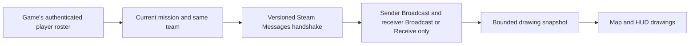

# Drawing sharing in the 0.6.0 local preview

Sharing sends map drawings, including ones attached to units, to compatible Steam teammates. It starts off. Private two-player tests confirmed drawing delivery, and the author reported a successful repeat test after the BRA update. Both clients must use this updated build: its version-6 protocol can't pair with earlier previews, which the status line shows as a teammate on another version.

An opposing faction never receives drawings, even if it uses the same channel names. Spectators do not receive drawings in this preview. Dedicated-server and UDP sessions stay local-only. There is no cross-faction or host override in the client-only build.

## Channels and ownership

Open **Tools → Channels** on the full map. **Broadcast** channels send, receive and allow collaboration. **Receive only** adds channels whose drawings you can view but cannot edit. Broadcast membership takes precedence if a name appears in both lists. Choose sharing on or off, then **Apply**. Both fields convert typed and pasted capitals to lowercase immediately. The visible **Draw to** indicator names the channel assigned to new drawings; click a numbered Broadcast button to change it. **Cancel**, Escape, or closing the map discards unapplied edits. Invalid input shows an error and leaves both active lists unchanged. These controls save to the existing config file and do not appear in F1 settings.

For example, player A can broadcast `command,medusa`; player B can broadcast `ifrit` and list `command` under Receive only. B sees A's `command` drawings, but cannot send to or erase on `command`. A sender's Broadcast list and either recipient list must contain the channel. Each list accepts up to ten comma-separated names, 32 characters per name, and 512 characters total. Names use ASCII letters, digits, spaces, dots, underscores, or hyphens. They are trimmed and made lowercase. Duplicate names collapse to one slot. Invalid configuration-file input disables sharing until corrected.

New drawings use the first Broadcast channel initially. With the full map open, Shift+1 through Shift+9 select Broadcast slots 1 through 9; Shift+0 selects Broadcast slot 10. Receive channels take no number slots. Both Shift keys work. Chat, text entry, and menus keep their input. Changing the destination cancels an unfinished drawing. Existing drawings keep their original channel when settings are reordered, or the drawing is edited, undone, or redone. On the map, every drawing on another channel, yours or a teammate's, draws half as opaque and darker, so switching channels shows which drawings the new one covers. The Waypoint tool's guide line dims with its route.

An empty Broadcast list makes new drawings local. A receive-only player can see subscribed drawings without sending any. Drawings on channels you no longer broadcast remain yours but stop being shared. Changing teams makes all earlier drawings local-only, including anything undo or redo can restore. Leaving the mission discards drawings and history.

Received drawings never enter the local drawing store. Eraser and right-click can request an erase from the original owner when both players broadcast the channel. The highlight checks the owner's advertised lists and current request cooldown too. The drawing stays visible until its owner publishes the deletion; a successful send is not owner confirmation. Redraw a replacement on that Broadcast channel after the erase. Receive-only channels stay read-only; a visible read-only drawing under the cursor blocks erasing a local drawing directly beneath it. Drawings with zero alpha do not take eraser hits. Clear, undo, redo, and waypoint navigation affect only your work. An accepted shared erase is one edit in the original owner's history: it clears that owner's redo branch, and the owner can undo it and share the restored drawing. It adds no undo step for the requester. Channel membership is an honor system: any same-faction teammate with this mod can claim a channel name, so it does not enforce a private command role. Received routes show on the maps; they do not replace your route or add flight guidance. Received arrows, notes, and circles use the existing 3D labels and rings, subject to the HUD's caps.

BRA arrows may attach either endpoint to an aircraft or unit. Shared anchors carry only the unit's mission ID, with zero position and elevation. Each recipient resolves both endpoints through its faction's own tracks, calculating bearing, range, and altitude locally. A received drawing behaves like a local one: when the recipient's side loses a unit, the drawing stops where that side last knew it and reads `lost`. A unit the recipient's side never knew has no position to draw at, so a received arrow with such an endpoint is hidden from the map, HUD, and eraser until the recipient's side knows it. An arrow from your aircraft stays anchored to your aircraft for recipients. Circles, notes and routes attached to units work the same way: each recipient places them on its own tracks, and a route with a waypoint on a unit its side never knew hides whole until that side knows the unit.

## Transport and authorization

The mod uses the installed Steamworks.NET `SteamNetworkingMessages` API on a separate channel, `0x4E4D4F`. It adds no raw socket listener or external service. It does not write game chat or register new Mirage messages. The installed Mirage decoder adds error points for unknown message IDs, making that transport unsuitable for peers without the mod.

The installed Mirage Steam transport receives connection callbacks without checking socket ownership. A Harmony compatibility patch filters those callbacks before Mirage handles them: clients require their exact gameplay connection handle, and servers require their listen socket or an already-owned connection for terminal cleanup. This keeps drawing connections out of gameplay acceptance, disconnection, and poll groups. Sharing stays disabled if the patch cannot load. Its separate Harmony owner keeps the guard installed through plugin disposal because Steam Messages sessions can still have pending callbacks. Use this updated build on the player-host and both participating clients for the private playtest. Compatibility with an unmodified host remains unverified.

Every native session request, send, and receive checks the current authenticated game connection and `UnitRegistry.playerLookup`. The sender must have a server-synchronized Steam ID and the same non-null faction as the receiver. The wire epoch includes the mission network ID, synchronized mission-start time, and faction network ID. Each peer also proves its current random session nonce, and snapshots and erase requests use separate increasing sequence numbers. At most two distinct hello nonces from a peer are processed in 30 seconds, limiting reconnect churn. This excludes packets from previous missions, teams, subscriptions, or sharing sessions.

The game connects clients directly without joining the Steam matchmaking lobby as members, so discovery uses bounded capability handshakes to eligible teammates. Drawings are sent only after a compatible handshake. Ordinary unmodified teammates receive no game-protocol messages. UDP sessions and dedicated-server transports without the required player Steam identity are unsupported and remain local.

The [Nuclear Option EULA](https://store.steampowered.com//eula/2168680_eula_0) recognizes mods under its user-content rules, restricts reverse engineering outside that allowance, and prohibits cheating. It does not specifically approve this network path. Keep sharing off in public matches unless Shockfront confirms it is allowed. Private two-player tests identified the callback ownership failure and confirmed drawing delivery after the fix. Enforcement compatibility remains unverified.

Steam handles identity and transport encryption. Channel names are visible in the handshake and are not passwords or membership permissions; a teammate can claim any name. A recipient can copy drawings, and the game server remains the authority for faction membership. Steam may choose a direct peer connection, so sharing is not a promise that teammate IP addresses stay hidden. No antivirus, firewall, or server-policy outcome is claimed before live testing.

Native pointers are released even when a packet is rejected. Parsing uses explicit binary shape types, strict UTF-8, finite bounded coordinates, and bounded counts. It does not deserialize runtime types or execute received text. Notes render literally on the map and HUD, with rich-text parsing disabled. Notes containing only whitespace and Unicode Format characters are rejected; visible text can still include those characters, including joined emoji. Only manually drawn BRA arrows share unit references; no unit position, altitude, or tracking cache accompanies an anchor. The decoder rejects an anchored point carrying nonzero fallback coordinates or elevation. Other anchored drawing types remain local-only. Channel and faction checks apply equally to fixed drawings and BRA arrows.

## Resource limits

| Limit | Value |
| --- | --- |
| Periodic sharing work | At most 5 Hz, with at least 200 ms between ticks; missed ticks are skipped |
| Packet bytes | 65,536 |
| Shapes per owner snapshot | 100, of which at most 5 waypoint routes of up to 50 waypoints |
| Geometry points per owner snapshot | 3,000, including route points and anchors |
| Eligible peer slots | 32 other Steam IDs, selected lowest first regardless of mod presence |
| Received shapes across all peers | 400, split evenly: each teammate shows its oldest drawings up to an equal share, so up to four teammates show everything |
| Received geometry points across all peers | 10,000, split the same way; a stroke past a teammate's share is hidden whole |
| Native messages returned and drained per network tick | At most 32; additional messages remain queued in Steam |
| Messages per peer per one-second window before its channel resets | 40; Hello, acknowledgement and erase messages are never skipped below it, and only the newest of a peer's snapshots in one batch is decoded |
| Decoded messages globally per one-second window | 128, covering four messages from each of 32 peers |
| Owner snapshot send frequency | At most 2 per second per peer, only after an edit, a new pairing, or a heartbeat showing the teammate is behind |
| Erase request send frequency | At most 1 per second per peer |
| Probes to a teammate not yet known to run the mod | 3 per mission and faction, at 0, 60 and 300 seconds; channel changes do not renew them |
| Ready-peer heartbeat | Every 5 seconds: a Hello naming the last snapshot sent, answered with the newest snapshot the teammate holds |
| Silence before received drawings expire | 15 seconds |
| Consecutive non-OK native sends before peer restart | 3; retry after a 30-second cooldown |
| Asynchronous native session failure | One restart and 30-second cooldown per transport attempt; duplicate callbacks do not extend the deadline |
| Distinct quarantined Steam IDs | 64; reaching the cap stops sharing until toggled |

Sharing supports teams of up to 33 players, more than the game's 16-player lobbies allow. Each client selects the lowest 32 eligible same-faction Steam IDs other than its own. Unmodified teammates occupy slots too. With more than 33 eligible players including yourself, only the lowest 33 IDs can admit one another mutually. Higher IDs cannot share, even if everyone has the mod. This preview does not replace unmodified teammates with compatible peers outside those slots.

Roster refresh, peer expiry, receive polling, and scheduled sends run on the 5 Hz tick. Enablement and local mission, faction, connection, loading, and channel changes are checked every frame so revocation and clearing received drawings remain immediate. The tick deadline survives sharing resets; re-enabling or changing settings cannot create extra polling batches. A frame stall runs one batch on resumption without replaying missed ticks. Native session callbacks and direct erase requests retain their live authorization checks and individual rate limits; the game's Steam callback pump is unchanged.

Every message returned by the native receive call is released. The call pulls at most 32 messages or the remaining global one-second budget, whichever is smaller, and pulls nothing once the global budget is exhausted, leaving queued messages, including one-shot erase requests, for the next window. Returned messages rejected by authorization are released without decoding. The 32-message batch cap does not drain or discard the rest of Steam's queue. Each snapshot replaces the previous one, so when a batch holds several from one peer, after a stall or a burst of edits, only the newest is decoded. Hello, acknowledgement and erase messages are always decoded.

Malformed or oversized packets close that peer's drawing channel and quarantine its Steam ID. A frame from another protocol version is not malformed: that teammate's frames are ignored, the status line counts them as on another NO Map Overhaul version, and sharing resumes when they send a frame this version decodes, after updating and rejoining. More than 40 messages or 256 KiB from one peer in a one-second window, far above normal traffic, resets that peer's drawing channel instead: Steam discards the backlog and the two pair again after five seconds. A long stall or quick channel changes are not treated as an attack; a peer starting more than two new sessions in 30 seconds has the extra Hellos ignored. Quarantine survives remote timeout, disconnect, and roster rejoin. A local sharing reset clears it, including toggling sharing or changing the mission, team, connection, or channel configuration. The rejection record holds at most 64 distinct IDs. Reaching that cap stops all sharing and requires a local sharing toggle to retry.

A teammate's snapshots apply at most once every 0.5 seconds, the rate an honest sender uses. Each drawing a snapshot adds or changes, including one under a new ID, costs one point from that teammate's budget (200, refilled at 100 a second) and from a budget shared by all teammates (400, refilled at 200 a second); removals and unchanged drawings cost nothing. A snapshot that doesn't fit waits as that teammate's newest pending state and applies once the budget refills, so the latest drawings always arrive. Handshakes, heartbeats, and erase requests skip this queue. Each frame's version is read from its header before the payload is copied.

Three consecutive non-OK native send results, or an asynchronous native session failure, remove that peer's received drawings, close its mod channel, and rotate the local session nonce. A successful native send clears the failure streak. Duplicate failure callbacks cannot extend the 30-second cooldown. Eligible incoming session requests and bounded packets are still processed during outgoing backoff; sending waits for the deadline. A teammate becomes known to run the mod when a handshake completes, and stays known for the rest of the mission and faction. Until then they get three probes at most, 0, 60 and 300 seconds after they are first seen, so an unmodified player, whose native networking is shared with the game, sees at most three connection attempts per mission. The probe schedule survives channel changes and transport failures. A teammate who enables the mod or sharing later probes everyone themselves; every send lets Steam restart a broken Messages session, since an earlier unanswered probe leaves one behind. Known teammates keep the 5-second heartbeat and bounded retries. Previously compatible peers can retry after a transport failure. Transport restarts retain the receive and remote-nonce churn budgets.

Owner snapshots replace the previous owner snapshot atomically, including deletes. Identical heartbeat snapshots retain the existing drawings and label placements; changed content or order invalidates rendering. When an outgoing snapshot would exceed a packet limit, the oldest drawings that fit are sent and the status line names how many of the newest are not shared, until some are erased. The Text tool refuses notes with nothing visible in them, which the wire format would reject. Incoming snapshots are kept whole. When teammates together exceed the received budget, each shows only its oldest drawings up to an equal share, and a departure gives the others their drawings back. Malformed snapshots close only that peer's drawing channel. An erase request must name a shape ID in the last successfully sent snapshot for that peer and pass current channel checks. The sender's local drawings remain intact.

Sharing stops when disabled, while the mod or map tools are disabled, during diagnostics, during loading, or without a valid Steam team session. Transport exceptions during updates or erase requests stop sharing without disabling the rest of the mod. Teammates remove a silent peer's drawings after the timeout. Teardown closes only the mod's Steam Messages channel; the game's socket and callback pump remain owned by the game.

## Validation before release

For multiplayer diagnosis, enable **F1 → Diagnostics → Log network** on both clients and save both `BepInEx/LogOutput.log` files before relaunching. It defaults off. [Network logging](USER_GUIDE.md#logging-multiplayer-sharing) explains the events, privacy limits and output cap. Diagnostics do not change the sharing protocol or its limits.

`pwsh ./build/Release.ps1 -AllowDirty` runs the game-free tests, compiles against the installed game assemblies, and verifies both local packages. It does not launch or install the game. The protocol and peer tests exercise malformed frames, all shape types, session restart and replay, directional channels, edit requests, limits, and ownership isolation.

For focused protocol, peer, retry, quarantine, receive-budget, and collaborative erase checks after restoring the test project, run `pwsh ./tools/Test-Sharing.ps1`. A receive test double verifies that global exhaustion does not dequeue or release a queued erase request. These tests do not call native Steam APIs or verify live queue behavior.

Checked on two PCs so far: host and client joining in both orders, a teammate without the mod as client and as host, opposite teams sharing a channel name, a client reconnecting, channel changes, late enablement, switching sharing off and on, and owner and collaborative erase (see [testing](TESTING.md)). The game offers no team change within a mission, and a rejoining player keeps their faction. Still open: the cause of the rare client freeze recorded in [testing](TESTING.md): watch for `No frame for` and `blocked the game` warnings in LogOutput.log. Check aircraft-to-unit, unit-to-unit, and fixed-to-unit BRA, including different recipient tracks, track loss, reacquisition, and unit destruction. Test collaborative erase requests, Receive-only refusal, delayed owner updates, and labels replaced by a snapshot while hovered. Check the Channels panel with empty lists, ten maximum-length names, invalid input, Apply, Cancel, Escape, and map close/reopen; verify that typing never triggers drawing shortcuts or flight controls, and that controls resume afterward. Verify that ordinary chat, game controls, and NOAutopilot input remain usable. No public release is justified by compilation alone.
