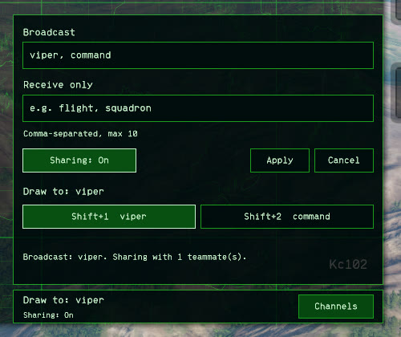
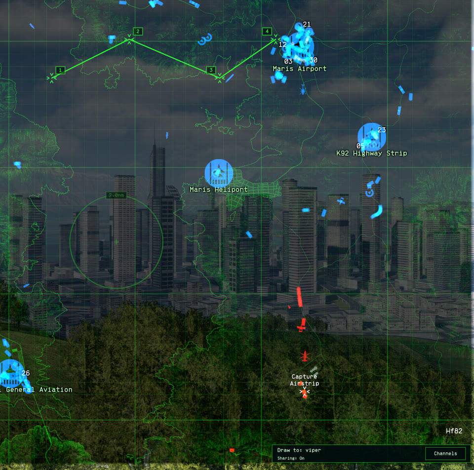
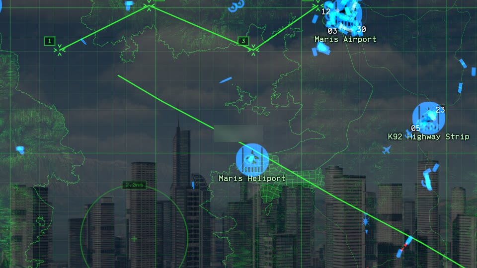

# Sharing drawings with your flight

Sharing shows your map drawings to teammates on your side who run NO Map Overhaul, and shows you theirs. You pick named channels, such as `viper` for your flight, and you see a teammate's drawing when you both use its channel. Sharing is off until you turn it on.

This guide is for players. [Sharing](SHARING.md) is the technical reference: the network design, the security checks, and every limit.

## Quick start

Everyone in the flight does this:

1. Install NO Map Overhaul 0.6.0, and join the same side in a Steam multiplayer game.
2. Open the full map and press `H` to open the tool rail. A bar reading **Draw to: Local** appears in the map's bottom-right corner. Click its **Channels** button.
3. In **Broadcast**, type the flight's channel name, such as `viper`. Click **Sharing: Off** so it reads **Sharing: On**, then click **Apply**.
4. The bar now reads **Draw to: viper** and **Sharing: On**. Draw something, and it shows on your flight's maps once your games pair. To check, click **Channels** again: the line at the bottom of the panel reads `Broadcast: viper. Sharing with 3 teammate(s).`

Your settings are saved, so next time you only need to join the same side.

## What gets shared

Pen lines, circles, text notes, waypoint routes, and Bearing/range arrows all share. They show on your teammates' full map and minimap. Arrows, notes, and circles also show in their 3D view, the same as yours do.

A drawing on a unit, such as a note on a contact or an arrow to a bandit, sends only which unit it's on. Each teammate's game places it using what their own side knows. When their side loses the unit, the drawing stops where it was last seen and reads `lost`, as yours does. If their side has never seen the unit at all, the drawing stays hidden until it does.

A teammate's route shows on your map, but it never becomes the route you fly. Your 3D waypoint markers still follow only your own route.

Teammates without the mod see nothing. Their game gets at most one connection attempt from yours per mission, and nothing else.

## How channels work

You have two lists of channel names:

- **Broadcast** channels are your working channels. Your new drawings go to one of them, you see teammates' drawings on all of them, and you can erase a teammate's drawing on a channel you both broadcast.
- **Receive only** channels are ones you want to watch. You see their drawings but can't draw on them or erase anything on them.

A teammate's drawing reaches you when its channel is in their Broadcast list and in either of your lists. With an empty Broadcast list, your drawings stay on your own map, and you only watch.

### Example: a squadron with a lead and two flights

| Player | Broadcast | Receive only |
| --- | --- | --- |
| Lead | `command, viper` | |
| Viper 2 and 3 | `viper` | `command` |
| Cobra 1 to 4 | `cobra` | `command` |

- Lead draws the package plan on `command`. Everyone sees it, and nobody else can erase it.
- Lead also flies with Viper, so Lead and the Viper wingmen draw on `viper` together and can erase each other's drawings there.
- Viper's and Cobra's flight drawings stay inside each flight. Cobra never sees `viper`, and Viper never sees `cobra`.
- If an AWACS player should also draw on `command`, they broadcast `command` too, and Lead and AWACS can then edit each other's `command` drawings.

### Typing channel names

- Separate names with commas. Each list takes up to 10 names, 32 characters each.
- Names use letters, digits, spaces, dots, underscores, and hyphens. Capitals turn lowercase as you type, so `Viper` and `viper` are the same channel.
- **Apply** saves both lists and the Sharing button. If a name isn't allowed, the panel shows why in amber and keeps your old lists.
- **Cancel**, Escape, or closing the map throws away changes you haven't applied.

## Choosing where new drawings go

**Draw to** on the bar names the channel your next drawing goes to. It starts on your first Broadcast channel, and reads **Local** while your Broadcast list is empty.

To change it, use either of these:

- In the Channels panel, click a Broadcast channel's button. Each button shows its key and name, such as `Shift+2  viper`.
- With the full map open, press `Shift+1` to `Shift+9` for Broadcast channels 1 to 9, and `Shift+0` for channel 10. Either Shift key works.

To rebind those keys, tick **Advanced settings** in F1 and change **Channel 1 key** to **Channel 10 key** under **Map Tools / Keys and Limits**. Clear a binding to turn its shortcut off. Receive only channels have no keys, since you can't draw on them.

A drawing stays on the channel you drew it on. Changing Draw to later, or editing, undoing, or redoing the drawing, doesn't move it. Changing Draw to halfway through a drawing cancels that drawing.

Drawings on any other channel, yours and teammates', show fainter and darker, so you can see at a glance what the current channel holds. **Other channels opacity** and **Other channels brightness** in **F1 → Map Tools / Drawing** set how faint. Set both to `1` to turn the dimming off.

You fly one route, whatever Draw to says. New waypoints, **Skip**, and **Restart** always act on it, and the route stays on the channel it started on.

## Seeing who drew what

On the full map, point at a teammate's drawing. Their in-game name shows beside the cursor, such as `Maverick`. It works with the tool rail open or closed. The name comes from the game's player list, so nobody can pass a drawing off as someone else's.

Your own drawings show no name. A drawing reads `Teammate` when the game can't name its owner yet, usually because Steam hasn't sent the name or the player has just left.

## Erasing a teammate's drawing

You can erase a teammate's drawing when you both broadcast its channel. Pick the Eraser (`6`) and point at it, and it turns red. Click to erase it. A right click does the same with any tool picked.

Your game asks theirs to erase it, so the drawing stays on your map until their game sends the change. To replace it, draw the new version on the same channel.

- Drawings on your Receive only channels never turn red and can't be erased. One of them also stops you erasing your own drawing directly beneath it.
- Undo (`Z`) and **Clear** act only on your own drawings.
- An erase you make lands in the owner's undo history, so they can undo it and bring the drawing back.

## Limits worth knowing

- **Your side only.** The other side never gets your drawings, even on a channel with the same name. Spectators get none.
- **100 drawings each.** Each player shares up to 100 drawings, with up to 5 routes of 50 waypoints. Past that, the status line reads `Sharing limit reached: your newest 2 drawing(s) aren't shared.` until you erase some.
- **400 teammates' drawings on your map.** Teammates' drawings share that space evenly, so four teammates with 100 drawings each fit. With more drawing heavily, each shows their oldest drawings up to an equal share, and a player leaving gives the others room back.
- **Up to 33 players on a side.** On a bigger dedicated server, only part of the side can share with each other.
- **Turning sharing off** removes teammates' drawings from your map at once. Your drawings leave their maps within 15 seconds.
- **A teammate who leaves** or goes quiet disappears from your map after 15 seconds.
- **Switching sides** keeps your earlier drawings on your map, but they stop being shared, including anything undo can bring back.
- **Leaving the mission** clears every drawing, yours and teammates', as it always does.

## Dedicated servers and player-hosted games

Sharing works on player-hosted games and on Steam dedicated servers, such as the big community servers. The server needs no mod. Drawings go between the players' own Steam accounts.

Servers running in UDP mode can't share, because the mod needs each player's Steam identity. There the status line stays on `Waiting for a Steam team session.`

Everyone who shares needs 0.6.0. Players still on a 0.6.0 beta pair with it too: beta 5 or later on a dedicated server, beta 3 or later on a player-hosted game.

## Privacy

- **Channel names are an honour system, not passwords.** Anyone on your side with the mod can type any channel name and see what's drawn there. Teammates' games can see the names you use. A teammate can screenshot or copy anything you share.
- **Your IP address on player-hosted games.** Steam may connect two players directly, so a teammate you pair with may learn your IP address. On dedicated servers, drawings go through Steam's relays, and teammates can't learn it.
- **The server decides who's on your side.** A modified server or host could list any Steam account as your teammate, and your drawings would go to it.
- **The network log is anonymous.** It labels teammates peer 1, peer 2, and so on, and leaves out Steam IDs, IP addresses, channel names, note text, and drawing positions.

## Troubleshooting

### What the status line means

The status line sits at the bottom of the Channels panel. It starts with where your drawings go (`Broadcast: viper.`, `Receive only.`, or `Local.` with an error), then one of these:

| Status | What it means |
| --- | --- |
| `Sharing off.` | Click **Sharing: Off** in the Channels panel, then **Apply**. |
| `Waiting for a Steam team session.` | You're not yet on a side in a Steam multiplayer mission, the mission is still loading, or the server runs in UDP mode. It also shows while both your channel lists are empty. |
| `Waiting for teammates with sharing enabled.` | Your game is looking, but no teammate has answered yet. |
| `Sharing with 3 teammate(s).` | Your game has paired with three teammates. Whether you see their drawings depends on your channels. |
| `2 teammate(s) on another NO Map Overhaul version.` | Those two run a version that can't pair with yours. |
| `Sharing limit reached: ...` | You have more than 100 drawings. Erase some to share the newest. |
| `Sharing unavailable; toggle sharing to retry.` | Sharing hit an error. Turn it off and on in the Channels panel. |
| `Sharing unavailable on this game build.` | A game update changed something the mod relies on. Report it with your log. |

### Nobody pairs

Work down this list with the teammate who doesn't pair:

1. Both of you are on the same side, in the same Steam multiplayer mission.
2. Both of you have 0.6.0 installed. Check that the mod loaded (see the [install guide](INSTALL.md)).
3. Both of you show **Sharing: On** on the bar, and pressed **Apply** after turning it on.
4. Both of you have at least one channel listed. A player with both lists empty doesn't share at all.
5. Pairing starts when the second of you applies. Check the status line again after a few seconds.

If the status line says you're sharing with them but their drawings don't show, compare channels. Their drawing's channel must be in their Broadcast list and in one of yours. Also check what their drawing is on: a drawing on a unit your side has never seen stays hidden.

### A teammate shows as on another version

Their build can't pair with yours. Both of you update to the latest release, then rejoin the mission.

### Sending a log

If sharing misbehaves, a log from both players finds the cause:

1. Both players turn on **F1 → Diagnostics → Log network**. It's off by default.
2. Reproduce the problem.
3. Before restarting the game, which overwrites it, each player copies `BepInEx/LogOutput.log` from the game folder.
4. [Open an issue](https://github.com/baanish/NO-Map-Overhaul/issues) with both logs, each player's Broadcast and Receive only lists, and what you expected to see.

The mod's network lines leave out Steam IDs, IP addresses, channel names, note text, and drawing positions. Other mods and the game may write personal details into the same file, so read it before posting. The [user guide](USER_GUIDE.md#logging-multiplayer-sharing) explains what the network lines record.
