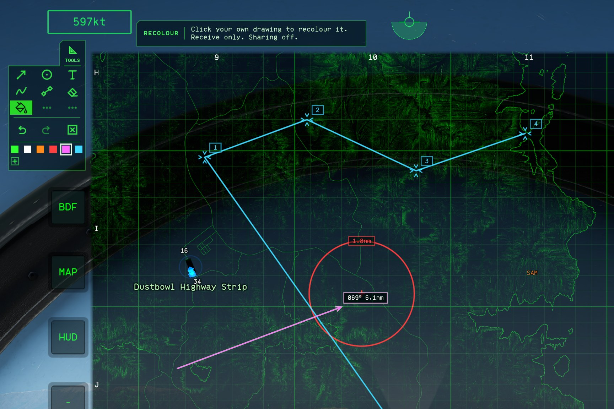
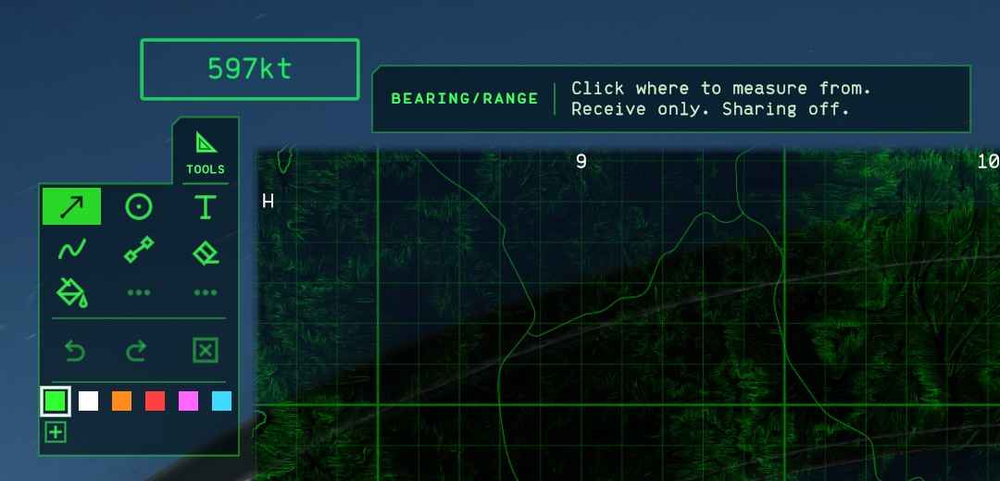

# NO Map Overhaul v0.6.1

You can now change a drawing's colour after you've drawn it, without erasing it and drawing it again.

## Recolour

- Pick a swatch, then pick **Recolour**, the rail's seventh tool, or press `7`.
- Point at one of your drawings and it shows in that colour. Click to keep it. Undo puts the old colour back.
- It works on pen lines, circles, notes, routes and Bearing/range arrows. A circle's ring and a note's label in the 3D view change too.
- A drawing you share changes colour for your teammates as well. A teammate's drawing keeps the colour they gave it.

## A 3x3 rail

The tools now sit in a 3x3 grid with flatter cells, so the rail still fits beside the map. The two dimmed cells after Recolour are marked coming soon, for the next tools.

## Upgrading

Nuclear Option Mod Manager updates it for you. By hand, extract the plugin-only archive over your install. Settings carry over from 0.6.0, and sharing works between 0.6.0 and 0.6.1.

The [changelog](../../CHANGELOG.md) lists every change. 364 automated tests pass, and [testing](../TESTING.md) records the in-game checks.

## Downloads

- `NoMapOverhaul-v0.6.1-nomm.zip` is the flat package for Nuclear Option Mod Manager.
- `NoMapOverhaul-v0.6.1-plugin-only.zip` extracts beside `NuclearOption.exe` when BepInEx 5 is installed.
- `SHA256SUMS.txt` lists both archive checksums.

Configuration Manager isn't bundled. Install it separately to use F1.
